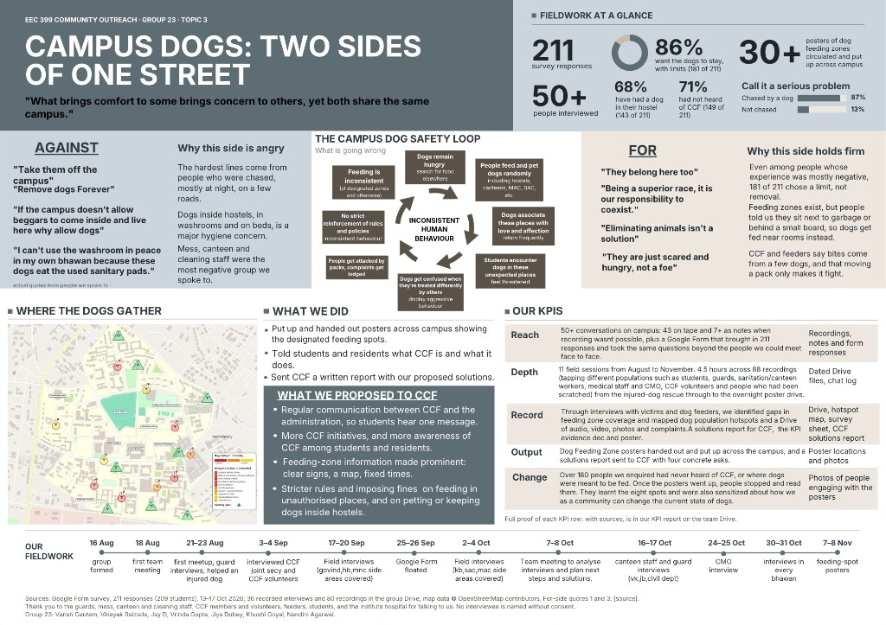

# Campus dogs: two sides of one street

**EEC 399 Community Outreach · Department of Electrical Engineering, IIT Roorkee · Autumn 2026–27**
Topic 3 · Group 23

[A3 poster (PDF)](deliverables/campus-dogs-poster.pdf) · [KPI evidence report (PDF)](deliverables/kpi-evidence-report.pdf) · [KPI table](deliverables/kpi-table.md) · [Team Drive](https://drive.google.com/drive/folders/1RwPyoukOcCx7umyHtwqF9Zhilzpci8-V) · [Recordings (GitHub Releases)](https://github.com/Vinayak-RZ/community-outreach/releases)

This repository is the group's record of the fieldwork: the course material, the raw sources, the survey, the transcripts, the analysis, and the deliverables. Figures on this page come from `project-brief.md`, `course/course-overview.md`, `analysis/survey-analysis.md` and `deliverables/kpi-table.md`. The Drive folder is the one listed in `source/whatsapp/INDEX.md`.

## For the review

| Read this | What it is |
|---|---|
| [`deliverables/campus-dogs-poster.pdf`](deliverables/campus-dogs-poster.pdf) | The A3 poster. The image above is the same sheet. |
| [`deliverables/kpi-evidence-report.pdf`](deliverables/kpi-evidence-report.pdf) | The written account of the five KPIs (same text as the `.md`). |
| [`deliverables/kpi-table.md`](deliverables/kpi-table.md) | The same five rows, checked against the files on 24 Nov 2026. Where a team date and a file disagree, this table says so. |
| [Team Drive](https://drive.google.com/drive/folders/1RwPyoukOcCx7umyHtwqF9Zhilzpci8-V) | The shared folder of recordings, photos and documents. Inventory: `source/drive-inventory.csv`. |
| [`analysis/synthesis.md`](analysis/synthesis.md) | The findings, with the strength of each one and the sources behind it. |
| [`analysis/survey-analysis.md`](analysis/survey-analysis.md) | The survey of 211 responses. |
| [`deliverables/posters/campus-dogs.pdf`](deliverables/posters/campus-dogs.pdf) | The ten-slide deck. |

`source/` and `transcripts/` are the raw material, including real names. The poster and the written deliverables use roles and interview codes.

## Team

Vansh Gautam (team lead), Vinayak Raizada, Jay D, Vrinda Gupta, Jiya Dubey, Khushi, Nandini. Who did what, as recorded in the group chat, is in `project-brief.md` under "Team and roles".

<!-- status:start -->
## Status

_As of 24 Nov 2026. This is the latest account in the repository._

**Collected**

- Survey: 211 responses (13–17 Oct), de-identified copy in `source/survey/`.
- Interviews: **43 recorded and coded** (I01–I43; 24 students, 6 guards, 4 mess/canteen/sanitation staff, 3 CCF, 2 feeders, 1 faculty, 3 unclear) plus **7 unrecorded talks** (the CMO, 3 guards, 2 people who had been bitten or scratched, a canteen worker; `analysis/unrecorded-conversations.md`).
- Media: 88 recordings, 4.41 h. The 24 Nov bundle (8 recordings, about 40 photos of the feeding-zone poster drive) is logged in `evidence/poster-campaign-photos.md`. Those files are not in git, and they are not in a Release yet.

**Transcribed:** 88 of 88 recordings. See [`transcripts/INDEX.md`](transcripts/INDEX.md). The transcripts are machine-made. Check a line against the audio before quoting it.

**KPIs** ([`deliverables/kpi-table.md`](deliverables/kpi-table.md), v3, 24 Nov): Reach and Record met. Depth partly evidenced: several dates on the team's list do not match the files, person-hours were not logged, and there is no field diary. Output is evidenced for the 24 Nov poster drive. The solutions report sent to CCF is not in the repository, and there is no acknowledgement. Change is not met as the course defines it (no written confirmation).

**Not in the repository**

- Consent sheets, a contact log, a field diary, and a person-hours total.
- Hospital figures on bites, vaccination or sterilisation. The requests are on record. No figures were handed over.
- The CCF solutions report, and any reply to it.
<!-- status:end -->

## Aim and research questions

The course frames the work as enquiry rather than charity: go into a community on or beside campus, understand the problem with the people living it, and ask honestly whether technology helps (`course/course-overview.md`, slides 1–2).

For Topic 3 the deck asks: *"What happens when it's not safe to walk in a campus?"* (slide 8). The group's working questions:

1. **The afraid side.** What problems do people face because of campus dogs: bites, chases, dogs in hostels, hygiene, routes avoided after dark?
2. **The dogs' side.** What problems do the dogs face (food, injury, shelter, mistreatment), and who looks after them: CCF, feeders, guards?
3. **Population and territory.** Where are the hotspots, and how many dogs are there?
4. **Facts on record.** Health-centre bite and vaccination figures, sterilisation (ABC) status, existing policy.
5. **Consensus.** Where do both sides agree, and what coexistence proposal would both sides actually sign?

## What was done

| Strand | What | Where it stands (24 Nov 2026) |
|---|---|---|
| Interviews | Guards, canteen and mess staff, students, faculty, CCF, and the CMO at the institute hospital | 43 recorded and coded, plus 7 unrecorded talks. 88 recordings transcribed. The CMO interview is notes only: recording was not allowed. |
| CCF meeting | Google Meet with a CCF office-bearer, 24 Sep: feeding, medical care, sterilisation, shelter, hotspots | Auto-transcript in `source/ccf-gmeet-transcript.txt`. The same conversation is coded as I24. |
| Survey | Google Form "Condition of Dogs in campus", 13–17 Oct | **211 responses**, written up in `analysis/survey-analysis.md` |
| Field observation | Fieldwork night of 14 Oct; hostel and campus video and photos, several of them GPS-tagged; field notes; feeding-zone poster drive on 24 Nov | Earlier media in the Releases below. The 24 Nov photos are logged in `evidence/poster-campaign-photos.md` and are not in git. Notes in `source/gandagi.md`. |
| Records | Emails and visits asking the hospital for bite, vaccination and sterilisation figures | No figures received. The requests are noted in `project-brief.md` and `deliverables/kpi-table.md`. |

## Headline survey results (n = 211, 209 students)

From `analysis/survey-analysis.md`:

- 52.1% describe their experience with campus dogs as mostly negative; 21.8% as mostly positive.
- 67.8% have had dogs enter their hostel or building; 61.1% have felt unsafe or been chased.
- 85.8% chose a managed-coexistence boundary (out of hostels, designated areas, or vaccinated and sterilised only); 8.1% chose free movement. Removal was not a listed option: 7 people typed it in, and 26 of 98 free-text answers propose it.
- 70.6% did not know about organised sterilisation or the CCF.

## What the course asks for

From the course deck, slides 16–19. The deck schedules the final review as "October sometime" and does not give a date. The record in this repository runs through 24 Nov 2026.

1. **A3 poster**, printed, plus a PDF: [`deliverables/campus-dogs-poster.pdf`](deliverables/campus-dogs-poster.pdf). The slide deck is [`deliverables/posters/campus-dogs.pdf`](deliverables/posters/campus-dogs.pdf).
2. **KPI table**: five rows (Reach, Depth, Record, Output, Change), with the team's targets and the achieved figures, each backed by evidence. The checked table is [`deliverables/kpi-table.md`](deliverables/kpi-table.md). An earlier draft remains inside `project-brief.md` and is not the current table.
3. **Evidence**: geotagged photos, dated videos, interview records, datasets, consent sheets and a dated field diary. The deck says a claim with no evidence is treated as not done. The gaps are listed under Status.
4. **Group and individual viva.** `analysis/synthesis.md` is the shared account of the findings.

## What's in each folder

| Path | Contents |
|---|---|
| `project-brief.md` | Compilation of 19 Oct 2026: course requirements, the team, the interviews then on file, and an early KPI draft. Later counts are in the Status section above. |
| `course/` | Course deck (`.pptx`), extracted text, and `course-overview.md` |
| `source/` | Raw inputs: the group chats, the Drive inventory, the de-identified survey, the CCF transcript, field notes. See `source/README.md`. |
| `transcripts/` | Machine transcripts of the interview audio and video, one folder per recording |
| `interviews/` | Reserved for interview notes. The coded record is in `analysis/interview-coding.md`. |
| `evidence/` | Logs of the poster-drive photos and the hotspot walk. Consent sheets and a field diary are not here. |
| `analysis/` | Survey write-up, interview coding, synthesis, and the charts in `figures/` |
| `deliverables/` | KPI report, KPI table, poster files, slide deck |
| `pipeline/` | Scripts that produced the transcripts. See `pipeline/README.md`. |

## Recordings

Audio and video are not committed. They are published as GitHub Release assets: https://github.com/Vinayak-RZ/community-outreach/releases

- [`source-media-v1`](https://github.com/Vinayak-RZ/community-outreach/releases/tag/source-media-v1): the original Drive audio and the smaller videos.
- [`raw-drive-videos-v1`](https://github.com/Vinayak-RZ/community-outreach/releases/tag/raw-drive-videos-v1): the twelve large Drive videos, including the recording of 25 Sep.
- [`comm-kaam-media-v1`](https://github.com/Vinayak-RZ/community-outreach/releases/tag/comm-kaam-media-v1): media forwarded in the second WhatsApp group.

The 24 Nov poster-drive photos and recordings are logged in `evidence/poster-campaign-photos.md` and are not attached to a Release yet. What each of the earlier releases contains is listed in `source/README.md`.

Transcripts were made with Whisper. An English file (`.en.*`) is a translation, not the speaker's words. Faces in videos prepared for sharing are blurred. The scripts and the model notes are in `pipeline/README.md`.

## Privacy

`source/` and `transcripts/` contain raw material with real names. On the poster, in `deliverables/`, and in `analysis/`, people are referred to by role or by an interview code, unless a written consent covers publishing the name (course ethics, slide 20). The repository is the course record. It is not a public release.

## Tools

Grok models in Cursor were used in this repository, including the analysis and the written documents.
