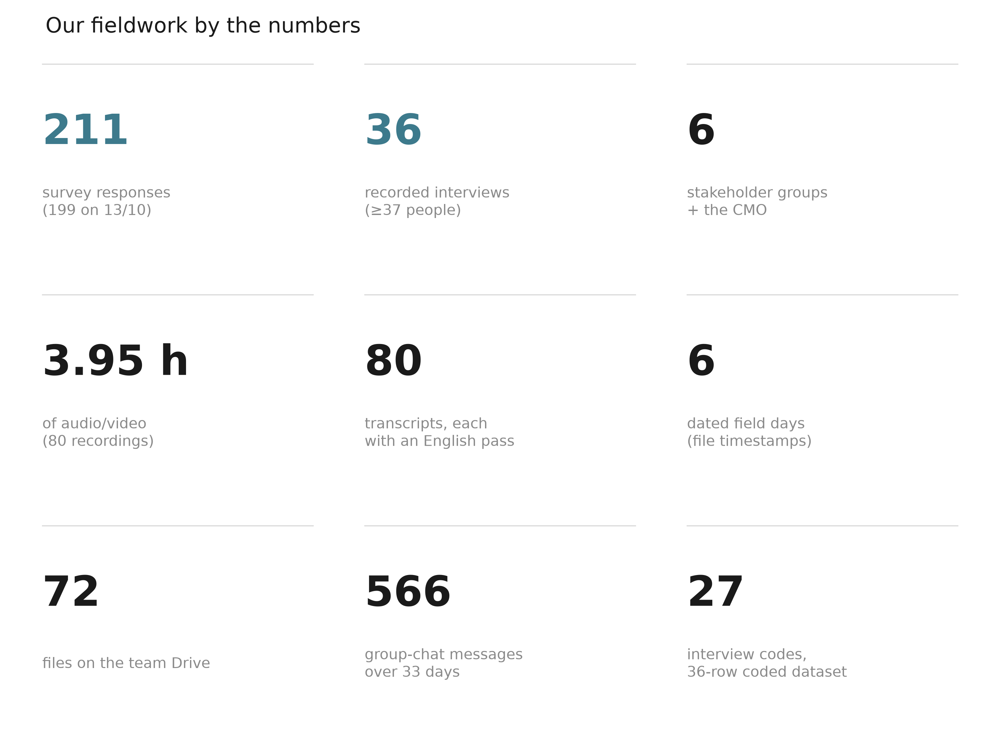
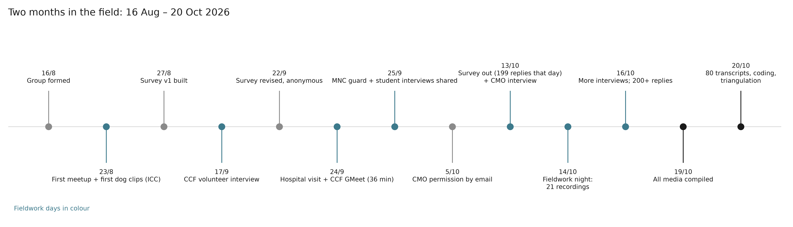
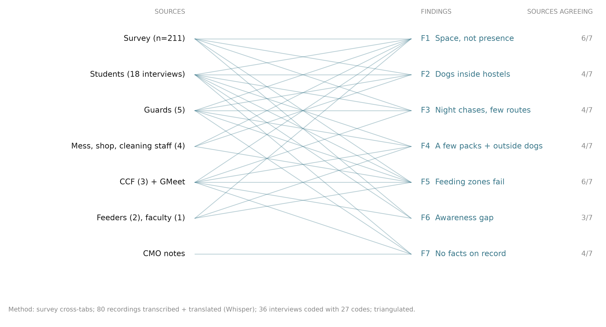

# Work log: how we got here (group 23, campus dogs)

_Built 20/10/2026 from the WhatsApp chat (`source/whatsapp/timeline.md`, `raw-transcript.txt`), file timestamps (`transcripts/INDEX.md`, `source/media-metadata.csv`) and the repo history. Dates are 2026, IST. **(est.)** marks an estimate._

## By the numbers
| | |
|---|---|
| Survey responses | **211** (199 on 13/10, the day it went out) |
| Recorded interviews | **36** distinct, at least 37 people |
| Stakeholder groups | **6** (students, guards, mess/shop/cleaning staff, CCF, feeders, faculty), plus the CMO |
| Audio and video | **3.95 h** across 80 recordings; 3.45 h of it is interviews |
| Transcripts | **80** originals + 80 English passes; 3 second-model spot-checks |
| Dated field days | **6** (23/8, 17/9, 24/9, 13/10, 14–15/10, 16/10) |
| Recording locations | **~11** (est.) |
| Team Drive files | **72**; 3 GitHub media releases |
| Team chat | **566** messages over 33 active days |
| Outreach emails | **3** to institute offices (from chat; contents not seen) |
| Analysis | 27-code codebook, 36-row coded dataset, 7 findings, 11 figures |

## Timeline

| Date | What happened | Evidence |
|---|---|---|
| 16/8 | Group formed, team lead named | chat |
| 17/8 | Topic assigned; first plan (guards, hospital, CCF, both sides) | chat |
| 23/8 | First meetup at ICC; first dog clips filmed 19:17–19:50 (9 clips, incl. IMG_5268 and IMG_0576) | chat, file timestamps |
| 27/8 | Survey v1 built (3-option removal question added) | chat |
| 16/9 | Work restarted; decision to interview "dog haters" too, on video | chat |
| 17/9 | CCF volunteer interview (11:32) | `ccf bhavagna interview` |
| 21–22/9 | Survey cut to 5 core questions, made anonymous; hospital questionnaire drafted | chat |
| 24/9 | Hospital visit; dog-bite and MNC guard interviews; CCF office-bearer GMeet at 9:30 pm (36:26) | chat, `Recording 2026-09-25 163540`, CCF transcript |
| 28/9 | CCF written reply (datasheet held by admin; 90–100 dogs; second-hand) | chat |
| 30/9–5/10 | Emails for the CMO permission; granted 5/10 | chat |
| 13/10 | Survey circulated (199 responses that day); CMO interview (notes only); 3 hospital-day recordings | survey, chat |
| 14–15/10 | Fieldwork night 21:53–00:22: guards, canteens, students, the Robocon lab (21 recordings) | file timestamps |
| 15–16/10 | Emails to the director (CMO in copy) and the hospital chairperson; 3 more interviews; awareness poster draft | chat |
| 18–19/10 | All media pooled on Drive and in the repo | chat, repo |
| 19–20/10 | 80 recordings transcribed and translated; survey analysed; interviews coded; findings triangulated | repo history |

## Methods pipeline
1. **Survey.** Google Form, 3 versions; 211 responses; de-identified; distributions, cross-tabs (chased vs not, experience), free-text coding → `analysis/survey-analysis.md`.
2. **Interviews.** 36 conversations across 6 groups, on 6 dated days, at about 11 places (est.), plus the CMO (notes) and the CCF GMeet.
3. **Transcription with translation.** Whisper on every recording; Hindi kept in Devanagari with an English pass; quality rated; 3 spot-checks with a second model → `transcripts/`.
4. **Coding.** 27 codes in 4 themes (people's problems, dogs' problems, causes, solutions), stance −2…+2, reliability A/B/C → `analysis/interview-coding.md`.
5. **Triangulation.** Each finding checked across 7 source types, conflicts listed openly → `analysis/synthesis.md`.

